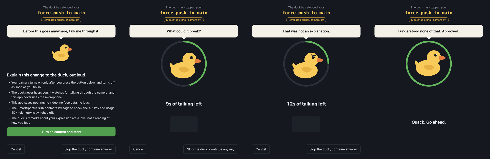

# Rubber Duck Gate

Developers explain bugs to rubber ducks. This duck is the reviewer.

Run `git push --force origin main` and the push stops. A window opens and a duck
asks you to explain your change out loud: what it does, what it could break, how
you would undo it. It takes 15 seconds of real talking to fill the ring. Stop
talking and the duck looks unimpressed. Finish and it quacks, and the push goes
through.

**The duck never hears you.** It knows you are talking from your face, using the
camera and the [Presage SmartSpectra SDK](https://smartspectra.presagetech.com/).
The app never uses the microphone.

Built for the DEV Presage SmartSpectra SDK Challenge.



These screenshots use the app's simulated signal, as the badge in each one says.

## What it stops

| Action | Stopped? |
| --- | --- |
| Force-push (history rewrite) to any branch | Yes |
| Any push to `main`, `master`, `production` or `prod` | Yes |
| Deleting a remote branch | Yes |
| Normal push to any other branch | No |
| Pushing or deleting tags | No |

Set your own protected branches with `DUCK_PROTECTED=main,release`.

## Setup

You need an Apple Silicon Mac, Linux (x64 or ARM64) or Windows x64, Node.js 22.12
or newer, a camera, and a free API key from
[physiology.presagetech.com](https://physiology.presagetech.com). It has only been
run on an Apple Silicon Mac so far.

```bash
git clone https://github.com/RohanPandeydev/rubber-duck-gate.git
cd rubber-duck-gate
npm install                 # about 400 MB: the SDK ships every platform's runtime
cp .env.example .env        # then put your key in .env
```

Install the hook in any repository:

```bash
cd your-repo
node /path/to/rubber-duck-gate/bin/duck.js install
```

If that repository already has a `pre-push` hook, it is left alone and you are
told. Remove ours with `duck.js uninstall`.

You can also put the duck in front of any command, such as a deploy:

```bash
node /path/to/rubber-duck-gate/bin/duck.js run -- npm run deploy
```

To meet the duck without a real push: `npm start`.

On a Mac, the first run asks whether **Electron** may use the camera. The app
launches itself through `open` so that macOS asks about Electron, not about the
editor or terminal you pushed from.

## How it works

1. `bin/duck.js` reads the refs git passes to the `pre-push` hook. `src/risk.js`
   decides whether the update is risky. If not, nothing happens.
2. If it is, Electron opens `app/`. The renderer uses SmartSpectra's
   `@smartspectra/node-sdk/renderer` and requests the face metrics.
3. Each `metrics` event carries live `face.talking` samples. `src/talk-meter.js`
   adds up talking time and bridges the short gaps between words.
4. `face.expression` gives the duck something to say. A confident smile gets "Why
   are you smiling? What did you do?"
5. At 15 seconds the camera turns off and the app reports success, so git
   continues. Cancelling or closing the window stops the push.

The SDK's validation messages (too dark, no face, hold still) become plain
instructions on screen. Network errors get one automatic retry.

## Consent and data handling

- **Camera consent.** The camera stays off until you press "Turn on camera and
  start". It turns off when you finish, cancel, skip or hit an error, and after
  3 minutes at most.
- **No microphone.** The app requests video only and denies any other permission.
  The quack is generated by the app.
- **What this app stores.** Nothing: no video, no face data, no history. It has no
  server, analytics or AI service of its own.
- **`DUCK_DEBUG=1`.** This optional developer setting prints the talking flag to a
  log you choose. It is off by default.
- **What the SDK sends.** The SDK processes video on the device and contacts
  Presage to validate the API key and usage, and may fetch device keys and models.
  See Presage's
  [privacy documentation](https://github.com/Presage-Security/SmartSpectra/blob/main/docs/telemetry-and-privacy.md).
- **SDK telemetry is off.** This app sets `enableTelemetry: false`, so the SDK's
  aggregate session summary is not sent.
- **API key.** It lives in your local `.env`, which git ignores.
- **Deleting data.** There is nothing to delete. To remove the tool, run
  `duck.js uninstall` and delete this folder.
- **You stay in control.** "Skip the duck, continue anyway" is always on screen, and
  `git push --no-verify` bypasses the hook as usual.
- **Not a measurement of you.** The expression remarks are a joke. The app makes no
  health, stress, emotion or diagnostic claims, and it should not be used to
  monitor anyone who has not agreed to it.

## Tests

```bash
npm test          # push-risk rules and talk metering
npm run test:ui   # drives the real window with a simulated signal
```

## License

MIT for this project's code. The SmartSpectra SDK is a separate dependency under
[Presage's terms](https://physiology.presagetech.com/tos).
