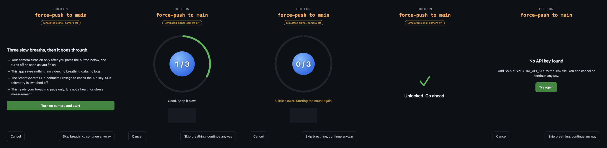

# Breathe Before You Push

A git hook that locks risky pushes until you take three slow breaths on camera.

Run `git push --force origin main` and the push pauses. A window opens, you press
a button to turn the camera on, and a ring fills as you breathe. Rush it and the
count restarts. After three slow breaths the push goes through.

Built for the DEV Presage SmartSpectra SDK Challenge. The breathing signal comes
live from the [Presage SmartSpectra SDK](https://smartspectra.presagetech.com/).



These screenshots were taken with the app's simulated signal, as the badge in
each one says.

## What pauses

| Action | Paused? |
| --- | --- |
| Force-push (history rewrite) to any branch | Yes |
| Any push to `main`, `master`, `production` or `prod` | Yes |
| Deleting a remote branch | Yes |
| Normal push to any other branch | No |
| Pushing or deleting tags | No |

Set your own protected branches with `BREATHE_PROTECTED=main,release`.

## Setup

You need an Apple Silicon Mac, Linux (x64 or ARM64) or Windows x64, Node.js 22.12
or newer, a camera, and a free API key from
[physiology.presagetech.com](https://physiology.presagetech.com). The hook has
only been run on an Apple Silicon Mac so far.

```bash
git clone https://github.com/RohanPandeydev/breathe-before-you-push.git
cd breathe-before-you-push
npm install                 # about 400 MB: the SDK ships every platform's runtime
cp .env.example .env        # then put your key in .env
```

Install the hook in any repository:

```bash
cd your-repo
node /path/to/breathe-before-you-push/bin/breathe.js install
```

If that repository already has a `pre-push` hook, it is left alone and you are
told. Remove ours with `breathe.js uninstall`.

You can also gate any command, such as a deploy:

```bash
node /path/to/breathe-before-you-push/bin/breathe.js run -- npm run deploy
```

To try the window without a real push: `npm start`.

## How it works

1. `bin/breathe.js` reads the refs git passes to the `pre-push` hook.
   `src/risk.js` decides whether the update is risky. If not, nothing happens.
2. If it is, Electron opens `app/`. The renderer uses SmartSpectra's
   `@smartspectra/node-sdk/renderer` and requests the breathing metrics.
3. Each `metrics` event carries a slice of `breathing.upperTrace`, the live chest
   waveform. `src/breath-counter.js` smooths it and finds peaks. One peak-to-peak
   cycle is one breath. A breath under 4 seconds restarts the count.
4. After three slow breaths the camera turns off and the app exits with code 0,
   so git continues. Cancelling or closing the window exits with 1, so git stops.

The SDK's validation messages (too dark, no face, hold still) become plain
instructions on screen.

## Consent and data handling

- **Camera consent.** The camera stays off until you press "Turn on camera and
  start". It turns off when you finish, cancel, skip or hit an error, and after
  3 minutes at most. The app requests video only, never the microphone.
- **What this app stores.** Nothing: no video, no breathing values, no history.
  It has no server, analytics or AI service of its own.
- **`BREATHE_DEBUG=1`.** This optional developer setting prints breathing values
  to your own terminal. They are still not saved by the app.
- **What the SDK sends.** The SDK processes video on the device and uses a server
  session with Presage to validate the API key. See Presage's
  [privacy documentation](https://github.com/Presage-Security/SmartSpectra/blob/main/docs/telemetry-and-privacy.md).
- **SDK telemetry is off.** This app sets `enableTelemetry: false`, so the SDK's
  aggregate session summary is not sent.
- **API key.** It lives in your local `.env`, which git ignores.
- **Deleting data.** There is nothing to delete. To remove the tool, run
  `breathe.js uninstall` and delete this folder.
- **You stay in control.** "Skip breathing, continue anyway" is always on screen,
  and `git push --no-verify` bypasses the hook as usual.
- **Not a medical tool.** It reads breathing pace to time a pause. It makes no
  health, stress or diagnostic claims, and it should not be used to monitor anyone
  who has not agreed to it.

## Tests

```bash
npm test          # push-risk rules and breath counting
npm run test:ui   # drives the real window with a simulated signal
```

## License

MIT for this project's code. The SmartSpectra SDK is a separate dependency under
[Presage's terms](https://physiology.presagetech.com/tos).
